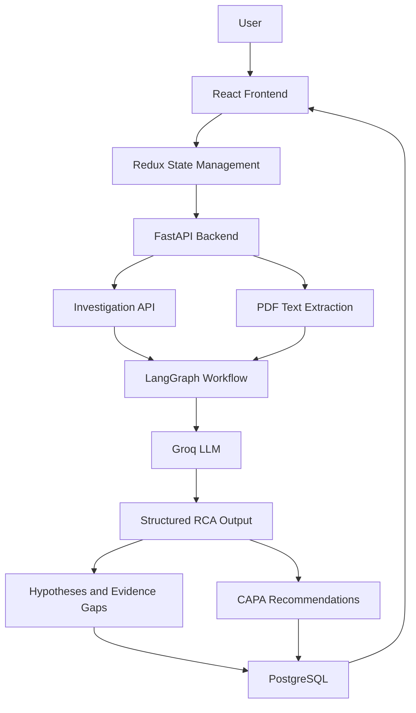

# TRACEORA AI
### Evidence-First Pharmaceutical Root Cause Investigation Platform

<p align="center">
  <strong>Turning manufacturing incidents into structured, evidence-driven investigations.</strong>
</p>

<p align="center">
  
  
  
  
  
  
</p>

---

## Overview

**TRACEORA AI** is an AI-powered pharmaceutical Root Cause Analysis (RCA) platform designed to support the investigation of manufacturing incidents.

Pharmaceutical manufacturing investigations involve reviewing incident descriptions, examining supporting documentation, identifying potential contributing factors, and defining corrective and preventive actions.

TRACEORA AI brings these activities into a unified investigation workflow.

It combines a React-based interface, a FastAPI backend, and a LangGraph-powered AI analysis workflow to transform incident information into structured investigation outputs.

The platform is designed around one principle:

> AI-generated conclusions should be connected to available evidence, with missing information and investigation limitations made visible.

## The Problem

Traditional incident investigation workflows can involve:

- Reviewing multiple documents and incident records.
- Manually organizing investigation findings.
- Identifying potential root causes.
- Recognizing missing or insufficient evidence.
- Preparing corrective and preventive action plans.
- Maintaining investigation records for future reference.

These activities can become fragmented and time-consuming.

## The Solution

TRACEORA AI provides a centralized workflow for:

- Creating pharmaceutical manufacturing investigations.
- Extracting text from supported PDF documents.
- Analyzing incident information through an AI workflow.
- Generating structured root cause hypotheses.
- Highlighting evidence gaps.
- Suggesting corrective and preventive actions (CAPA).
- Saving and reviewing investigation history.

## Key Features

### 1. Investigation Command Center
A centralized dashboard for accessing investigation workflows and reviewing investigation activity.

### 2. New Investigation
Create an investigation using manufacturing incident information and supporting documentation.

### 3. AI-Powered Root Cause Analysis
Uses a LangGraph-based workflow with Groq-powered language model inference to generate structured investigation analysis.

### 4. Root Cause Hypotheses
Organizes potential contributing factors into readable investigation hypotheses for human review.

### 5. Evidence Gap Identification
Highlights information gaps that may require additional investigation or supporting evidence.

### 6. CAPA Studio
Generates suggested Corrective and Preventive Actions (CAPA) to support investigation follow-up.

### 7. Investigation History
Persists investigation records and supports retrieval of previously created investigations.

### 8. PDF Text Extraction
Extracts selectable text from supported PDF documents for use in the investigation workflow.

---

## Technology Stack

| Layer | Technologies |
|---|---|
| Frontend | React, JavaScript, HTML, CSS |
| Frontend tooling | Vite, npm |
| State management | Redux |
| Backend | Python, FastAPI |
| AI orchestration | LangGraph |
| LLM inference | Groq |
| Database | PostgreSQL |
| Document processing | PyMuPDF |
| API communication | REST APIs |

## System Architecture



## Project Structure

```text
TRACEORA-AI/
│
├── backend/
│   ├── main.py
│   ├── check_models.py
│   ├── requirements.txt
│   └── SETUP.txt
│
├── frontend/
│   ├── src/
│   │   ├── App.jsx
│   │   ├── main.jsx
│   │   ├── store.js
│   │   └── style.css
│   ├── index.html
│   ├── package.json
│   ├── package-lock.json
│   └── vite.config.js
│
└── README.md
```

## Getting Started

### Prerequisites

- Python 3.10 or compatible version required by the backend dependencies.
- Node.js and npm.
- PostgreSQL, if using the PostgreSQL configuration.
- A Groq API key for AI-powered analysis.

### 1. Clone the Repository

```bash
git clone https://github.com/VaniSharma06/TRACEORA-AI.git
cd TRACEORA-AI
```

The application files are currently inside the nested `TRACEORA-AI/` directory:

```bash
cd TRACEORA-AI
```

### 2. Configure the Backend

```bash
cd backend
python -m venv .venv
```

Activate the virtual environment.

Windows PowerShell:

```powershell
.venv\Scripts\Activate.ps1
```

Install dependencies:

```bash
pip install -r requirements.txt
```

Configure the required environment variables according to the backend configuration in `main.py` and `SETUP.txt`.

Do not commit API keys, database passwords, or `.env` files.

Start the backend:

```bash
uvicorn main:app --reload
```

### 3. Configure the Frontend

Open another terminal:

```bash
cd TRACEORA-AI/frontend
npm install
npm run dev
```

Open the local development URL displayed by Vite.

---

## Example Investigation

The prototype includes a synthetic pharmaceutical manufacturing incident:

**Incident ID:** BATCH-104

The example concerns a batch with moisture content above its approved specification.

The workflow demonstrates how incident information can be organized into:

1. Investigation analysis.
2. Potential root cause hypotheses.
3. Evidence gaps requiring further review.
4. Corrective and preventive action suggestions.
5. A persisted investigation record.

All example incident information is synthetic.

## Engineering Highlights

This project demonstrates practical implementation of:

- Full-stack application development using React and FastAPI.
- REST API integration between frontend and backend.
- AI workflow orchestration using LangGraph.
- LLM-powered structured investigation analysis.
- PDF document text extraction.
- Database-backed investigation persistence.
- State management using Redux.
- Environment-based configuration for external services.
- Human-review-oriented presentation of AI-generated findings.

## Important Limitations

TRACEORA AI is a prototype and is not a validated pharmaceutical quality management system.

- It is not a replacement for qualified pharmaceutical quality professionals.
- AI-generated hypotheses and CAPA suggestions require human review.
- PDF extraction currently supports selectable text; scanned PDFs require OCR support.
- The current LangGraph workflow uses a Groq-powered analysis node.
- The implementation should undergo additional validation, testing, security review, and workflow expansion before any regulated production use.
- No real confidential manufacturing records should be uploaded to public demonstrations.

## Future Enhancements

- Multi-agent investigation workflows.
- OCR support for scanned manufacturing documents.
- Evidence traceability and source-level citations.
- Investigation approval and review workflows.
- Role-based access control.
- Audit trails and versioned investigation records.
- Automated testing and CI/CD integration.
- Deployment with production-grade monitoring and security.

## Author

**Vani Sharma**

Computer Science & Engineering | Full-Stack Development | AI Engineering

GitHub: [VaniSharma06](https://github.com/VaniSharma06)

---

<p align="center">
  <strong>TRACEORA AI — Evidence First. Investigation Driven.</strong>
</p>
